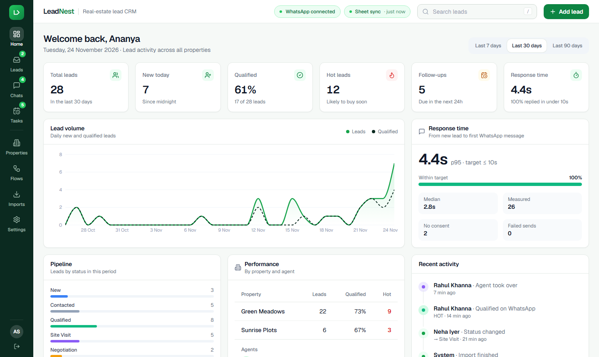
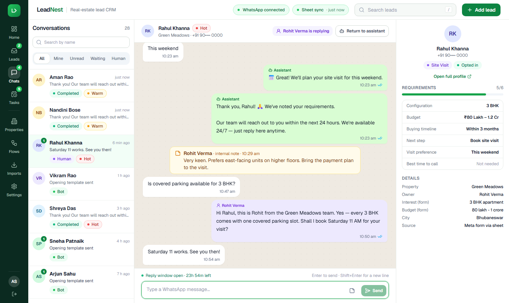
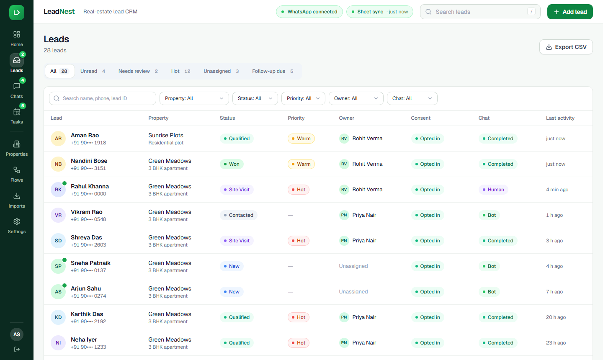
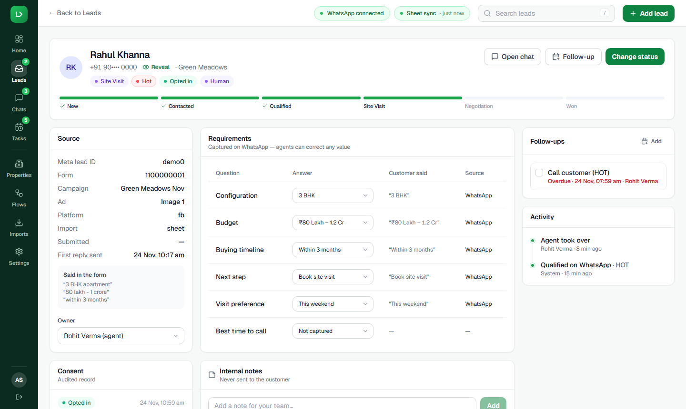
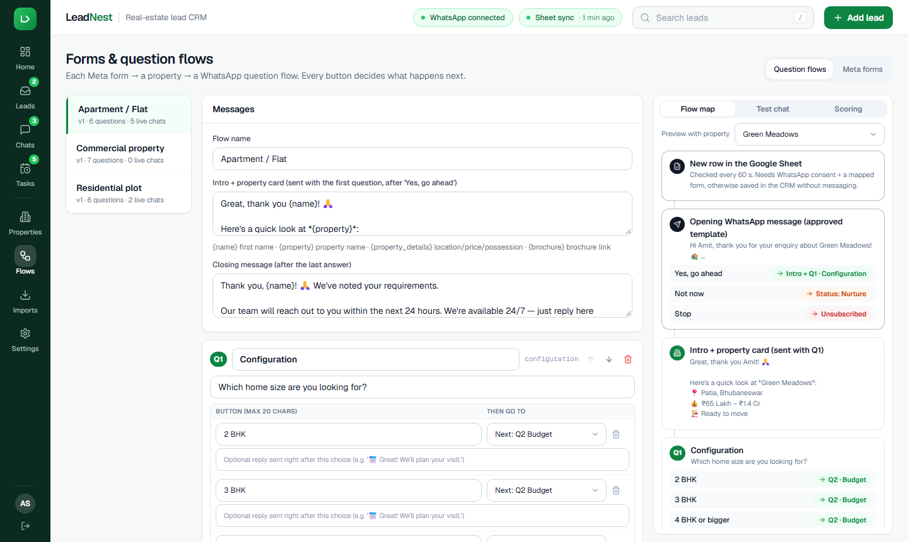
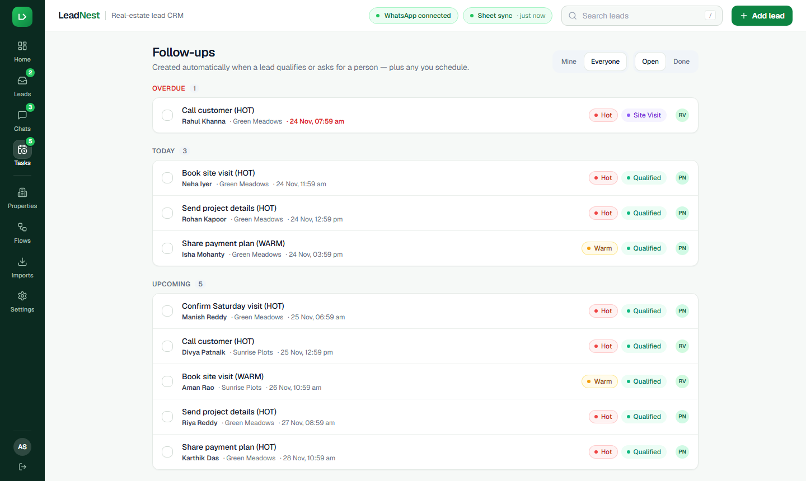
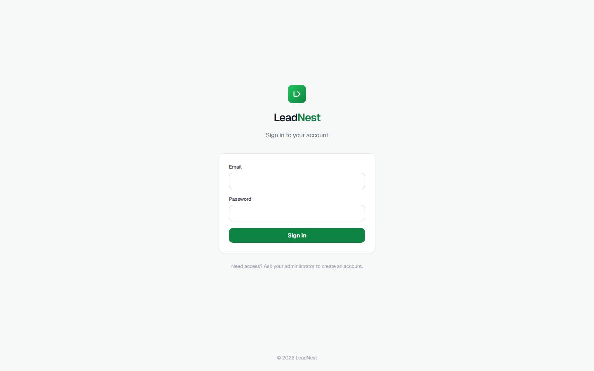
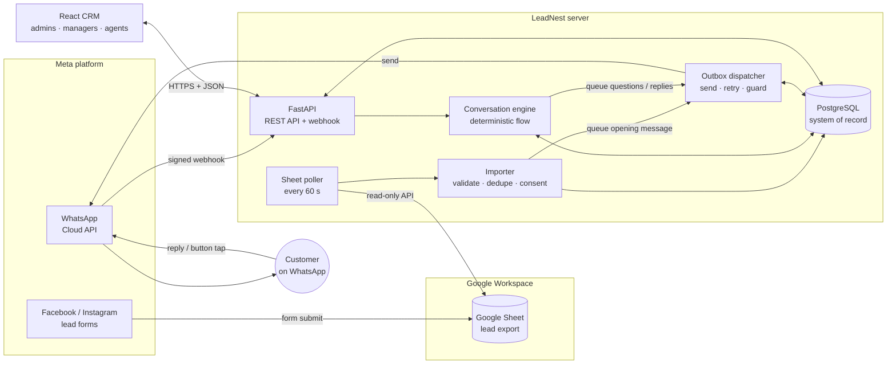
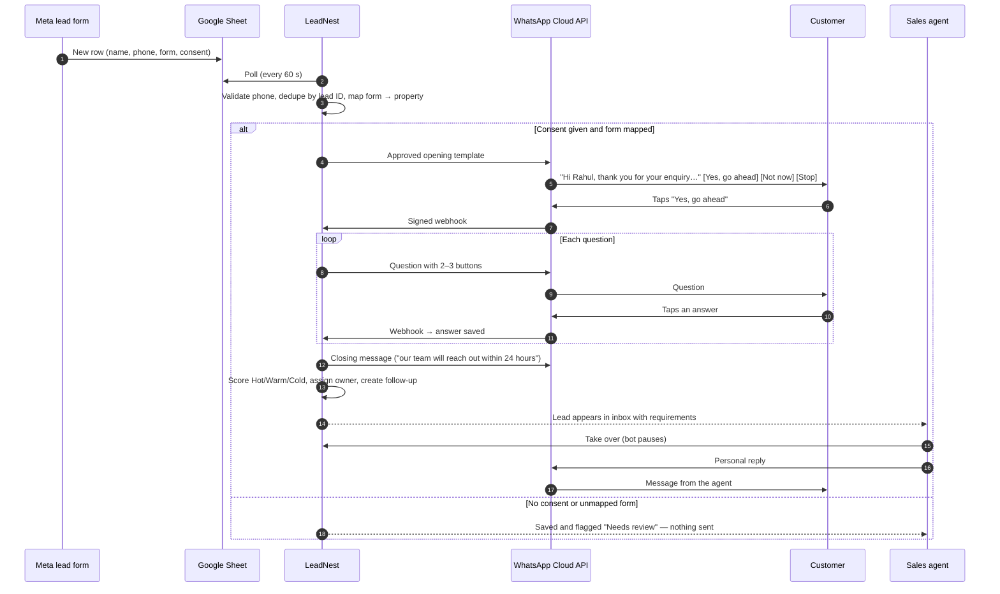

<div align="center">

# LeadNest

**Real-estate lead CRM that turns Meta lead-form enquiries into qualified WhatsApp conversations.**

New leads arrive from a Google Sheet, get an instant WhatsApp message, answer a short
tap-to-answer questionnaire, and land in your team's inbox already scored and assigned.




</div>

---

## Contents

- [Why LeadNest](#why-leadnest)
- [Screenshots](#screenshots)
- [Features](#features)
- [How it works](#how-it-works)
  - [System architecture](#system-architecture)
  - [Lead lifecycle](#lead-lifecycle)
  - [Lead scoring](#lead-scoring)
- [Tech stack](#tech-stack)
- [Project structure](#project-structure)
- [Getting started](#getting-started)
- [Configuration](#configuration)
- [Testing](#testing)
- [Security and privacy](#security-and-privacy)
- [Roadmap](#roadmap)

---

## Why LeadNest

Property enquiries from Facebook and Instagram ads usually land in a spreadsheet. Someone has to
notice them, work out which project they are about, call or message the customer, and keep notes
somewhere else. By then the buyer has often moved on.

LeadNest automates the first conversation:

| Before | With LeadNest |
|---|---|
| Leads sit in a spreadsheet until someone checks it | New rows are picked up within a minute |
| First reply depends on who is free | WhatsApp message goes out in a few seconds |
| Every agent asks different questions | Same short, property-specific questions for everyone |
| Requirements live in chats and notebooks | Answers saved as structured fields on the lead |
| Managers can't see who is ready to buy | Leads scored **Hot / Warm / Cold** and assigned automatically |

---

## Screenshots

> All screenshots use generated demo data — the names and numbers are not real.

| Conversation workspace | Leads |
|---|---|
|  |  |
| **Agent takeover, WhatsApp history, captured requirements** | **Filterable lead list with status, priority, owner and consent** |

| Lead profile | Question flow builder |
|---|---|
|  |  |
| **Sales-stage tracker, requirements, consent record, activity** | **Edit questions and buttons; see where every answer leads** |

| Follow-ups | Sign in |
|---|---|
|  |  |
| **Overdue, today and upcoming tasks** | **Simple role-based sign-in** |

---

## Features

**Lead capture**
- Reads Meta lead-form rows from a Google Sheet **instantly** (an Apps Script trigger in the sheet calls
  LeadNest the moment a row is complete) with a once-a-minute check as a safety net
- A row is only taken once its **Lead ID** is filled, so half-typed or copied rows are never messaged
- Clean sheet layout with plain-English headers, required-cell highlighting, dropdowns for
  Looking For / Budget / Consent / Platform and a "How it works" tab (`python -m app.cli sheet-layout`)
- Only **complete** rows (name, phone, email, city, consent) are messaged; filling a missing cell later
  sends the message automatically, and editing a row updates its lead
- Duplicate-proof: re-reading the same sheet never creates a second lead or message
- **Sheet rows report**: every row with its result (messaged, delivery status, or the exact reason it
  was not messaged), plus a summary on the dashboard

**WhatsApp conversation**
- Official **WhatsApp Business Cloud API** only — no unofficial automation
- Approved opening template, then tap-to-answer questions (WhatsApp reply buttons)
- Messages use what the lead form says (property, size, budget, location, details); the question flow
  is chosen from "Looking For" (BHK -> apartment, plot -> plot, office/shop -> commercial)
- A new enquiry from the same number takes over from the older one; inside the 24-hour window it
  opens straight away with the enquiry details (no template needed)
- Every button can route to a different next question, send its own reply, finish, or hand to a person
- Verified property card (location, price range, possession) sent from the property record — never invented
- `STOP` ends that enquiry's chat immediately; "call me" / "agent" hands the chat to a person

**Sales CRM**
- Automatic **Hot / Warm / Cold** scoring, owner assignment and follow-up tasks
- Three-column conversation workspace with live delivery ticks
- **Take over** any chat — the bot pauses instantly; **Return to assistant** continues without repeating questions
- Agents can message outside WhatsApp's 24-hour window through an approved template
- Lead profiles with a sales-stage tracker, editable requirements, internal notes and timeline
- Dashboard: lead volume, qualification rate, response time, pipeline, property and agent performance
- **Works on phones**: bottom tab bar, full-screen chats with take-over, lead cards, bottom-sheet
  forms; installable on the home screen like an app

**Administration**
- Roles: admin, sales manager, sales agent
- Properties, Meta form mapping and question flows managed in the UI
- Settings page shows integration health; append-only audit log of every sensitive action

---

## How it works

### System architecture



- **PostgreSQL is the single source of truth.** Google Sheets is only an input; WhatsApp is only a channel.
- **Every outgoing message goes through the outbox.** The dispatcher re-checks consent, opt-out,
  the 24-hour window and takeover status *at send time*, so a message queued before a STOP or a
  takeover is never delivered.
- **Webhooks are verified** with Meta's `X-Hub-Signature-256` HMAC and acknowledged immediately;
  processing happens in the background.

### Lead lifecycle



### Lead scoring

After the last answer, each lead is scored automatically (rules are editable in **Forms & flows**):

| Priority | Rule |
|---|---|
| 🔴 **Hot** | Buying within 3 months **and** asked for a site visit or call |
| 🟠 **Warm** | Buying within 6 months |
| 🔵 **Cold** | Everything else |
| ↓ | Budget below the property's starting price drops the lead one level |

---

## Tech stack

| Layer | Technology |
|---|---|
| Frontend | React 18, TypeScript, Tailwind CSS, TanStack Query, Recharts, Lucide icons |
| Backend | Python 3.11, FastAPI, SQLAlchemy 2, Pydantic 2, Alembic |
| Database | PostgreSQL 16 |
| Workers | In-process sheet poller and outbox dispatcher (PostgreSQL row locks; no Celery needed) |
| Messaging | WhatsApp Business Cloud API (Graph API) |
| Lead source | Google Sheets API via a read-only service account |
| Local infra | Docker Compose (PostgreSQL, Redis) |
| Testing | pytest (62 tests against a real PostgreSQL database) |

---

## Project structure

```
leadnest/
├── backend/
│   ├── app/
│   │   ├── api/            # REST endpoints: leads, conversations, imports, setup, dashboard, webhook
│   │   ├── core/           # settings, database, security, error handling
│   │   ├── models/         # SQLAlchemy models (users, leads, conversations, messages, …)
│   │   ├── services/       # importer, conversation engine, WhatsApp client, workers, flows
│   │   ├── cli.py          # admin & setup commands
│   │   ├── tunnel.py       # dev tunnel that keeps Meta's webhook URL up to date
│   │   └── main.py         # FastAPI app (also serves the built frontend)
│   ├── alembic/            # database migrations
│   └── tests/              # pytest suite
├── frontend/
│   └── src/
│       ├── pages/          # Dashboard, Leads, Conversations, LeadDetail, Forms, …
│       ├── components/     # layout, UI kit, flow map, WhatsApp simulator
│       └── lib/            # API client, auth, formatting, brand
├── deploy/                 # production stack, server setup, image shipping, sheet trigger script
├── infra/docker-compose.yml # local development database
├── docs/                   # deployment guide and screenshots
├── Dockerfile              # production image (builds the CRM, runs the API)
├── start.ps1               # one-command local start (Windows)
└── .env.example
```

---

## Getting started

### Prerequisites
- Docker Desktop
- Python 3.11+
- Node.js 20+
- A Meta developer app with the WhatsApp product (the free test number is enough to start)
- A Google Cloud service account with the Sheets API enabled

### 1. Configure

```bash
cp .env.example .env
python -c "import secrets; print(secrets.token_urlsafe(48))"   # paste as SECRET_KEY
```

Create `secrets/whatsapp.env` with your WhatsApp values (see [Configuration](#configuration)) and
save the Google service-account key as `secrets/google-service-account.json`.
Share your lead sheet with the service-account email as **Viewer**.

### 2. Start the database

```bash
docker compose -f infra/docker-compose.yml --env-file .env up -d --wait
```

### 3. Backend

```bash
cd backend
python -m venv .venv
.venv/Scripts/python -m pip install -r requirements-dev.txt      # macOS/Linux: .venv/bin/python
.venv/Scripts/alembic upgrade head
.venv/Scripts/python -m app.cli seed-demo                         # demo properties, forms and flows
.venv/Scripts/python -m app.cli create-admin --email you@example.com --name "Your Name"
```

### 4. Frontend

```bash
cd frontend
npm install
npm run build          # the API serves the built CRM
```

### 5. Run

```bash
cd backend
.venv/Scripts/python -m uvicorn app.main:app --port 8000
```

Open **http://127.0.0.1:8000** and sign in. On Windows, `./start.ps1 -Tunnel` does steps 2 and 5
and also opens a public HTTPS tunnel so WhatsApp replies reach your machine.

### Deploy for free

LeadNest runs on a free **Oracle Cloud Always Free** server with Docker, Caddy (automatic HTTPS)
and PostgreSQL — see **[docs/DEPLOY_ORACLE.md](docs/DEPLOY_ORACLE.md)** for the step-by-step guide.
The production stack is in [`deploy/`](deploy/) and the image is built from the root `Dockerfile`.
On a small 1 GB server, build on your PC and upload with `deploy/ship-image.ps1`.

### 6. Connect the WhatsApp webhook (local development)

Meta needs a public HTTPS URL. During development, run the tunnel keeper — it opens a tunnel and
re-registers the webhook with Meta whenever the address changes:

```bash
cd backend
.venv/Scripts/python -m app.tunnel
```

---

## Configuration

All settings come from `.env` and `secrets/whatsapp.env` — nothing client-specific is hard-coded,
so each client gets their own install.

| Variable | Purpose |
|---|---|
| `BUSINESS_NAME`, `TIMEZONE` | Client name and display timezone |
| `SECRET_KEY` | Signs login tokens — required, long and random |
| `DATABASE_URL` | PostgreSQL connection |
| `GOOGLE_SERVICE_ACCOUNT_FILE`, `GOOGLE_SHEET_ID` | Lead sheet access (read-only) |
| `WHATSAPP_PHONE_NUMBER_ID`, `WHATSAPP_BUSINESS_ACCOUNT_ID` | From Meta → WhatsApp → API Setup |
| `WHATSAPP_ACCESS_TOKEN` | Use a permanent System User token in production |
| `WHATSAPP_APP_ID`, `WHATSAPP_APP_SECRET` | Webhook signature check and webhook registration |
| `WHATSAPP_VERIFY_TOKEN` | Random string Meta echoes when verifying the webhook |
| `WHATSAPP_OPENING_TEMPLATE` | Approved template for the first message |
| `WHATSAPP_AGENT_TEMPLATE` | Approved template that carries agent messages outside the 24-hour window |

---

## Testing

```bash
cd backend
.venv/Scripts/python -m pytest
```

The suite runs against a separate `leadflow_test` PostgreSQL database rebuilt from the migrations
on every run, and never calls Meta or Google. It covers duplicate imports, invalid rows, the consent
gate, unmapped forms, every question-flow branch, STOP, webhook replays, out-of-order delivery
statuses, takeover races, the 24-hour window, template sending and role permissions.

---

## Security and privacy

- Secrets live only on the server (`.env`, `secrets/`) and are never sent to the browser or committed.
- Phone numbers are masked in the UI by default; revealing one is recorded in the audit log.
- Webhooks are rejected unless the Meta signature matches the app secret.
- Role-based access on every endpoint; agents only see their own and unassigned leads.
- Opt-outs are stored as hashes in a suppression list and checked before every send.

> Consent wording, data retention and WhatsApp pricing should be confirmed with Meta's current
> policies and your legal adviser before going live.

---

## Roadmap

- [ ] Direct Meta Lead Ads webhook (instant, without the sheet)
- [ ] Hosted deployment with a fixed HTTPS domain
- [ ] Brochure and image sending from the CRM
- [ ] AI answers to free-text property questions, grounded in approved property documents
- [ ] More languages (Hindi, Odia)
